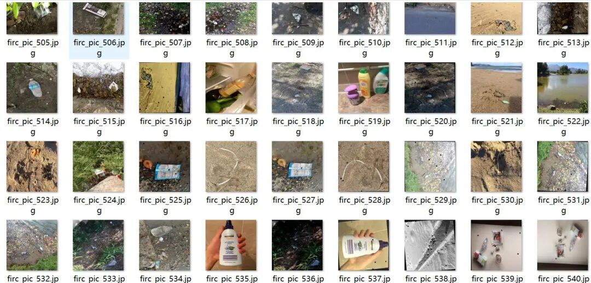
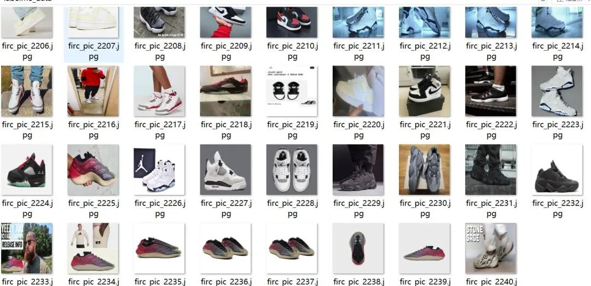
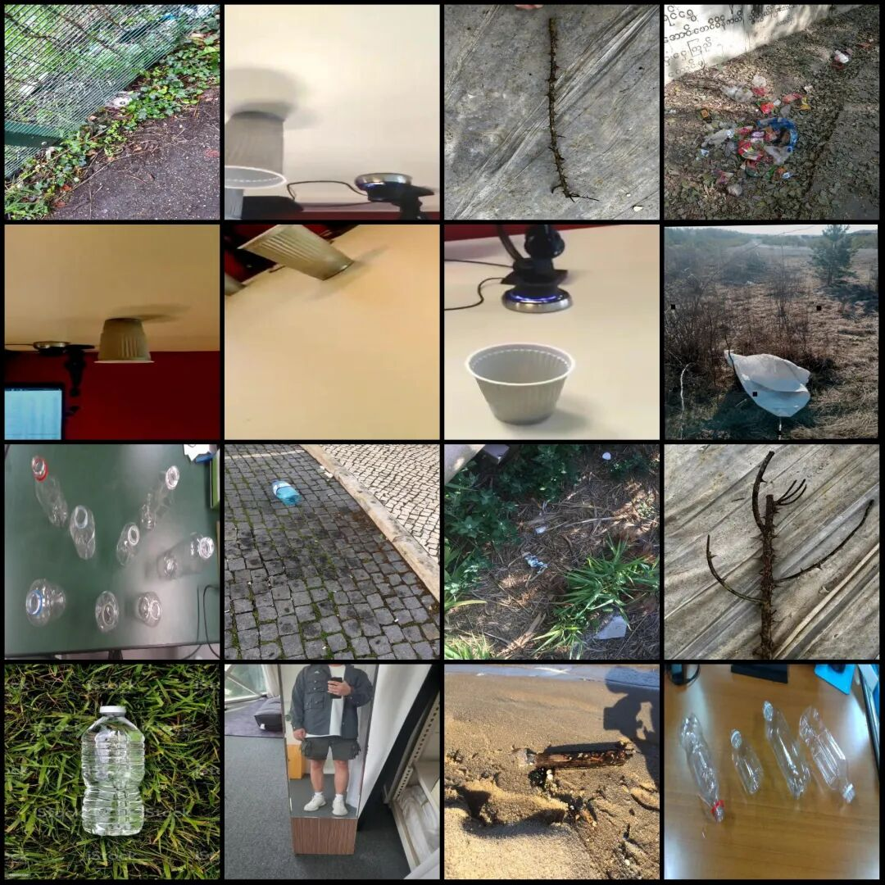
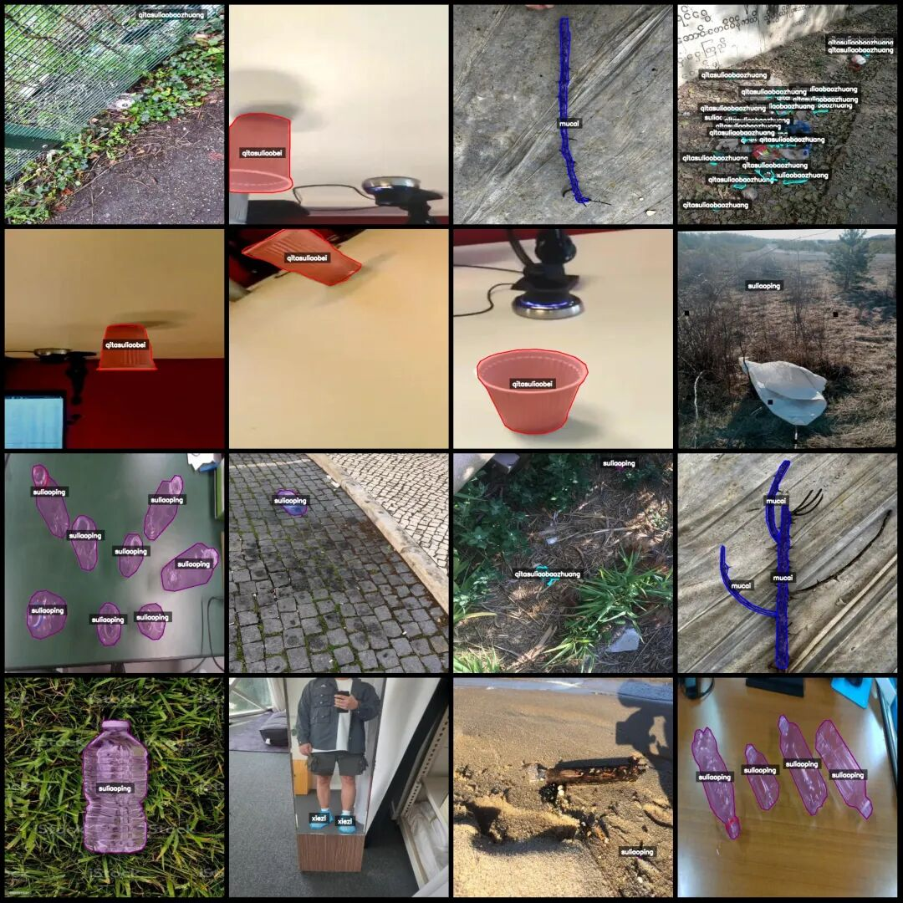
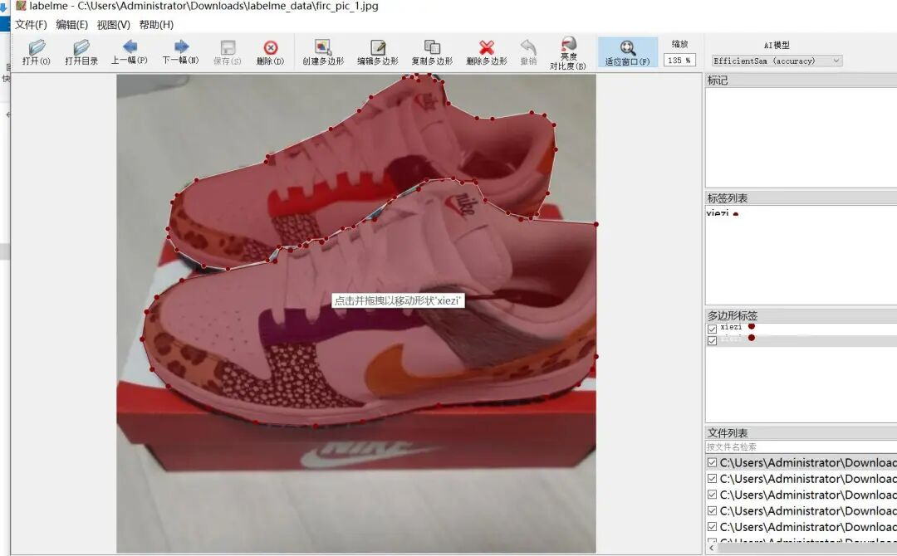

# Trash and Waste Identification and Segmentation Dataset - LabelMe format: 2240 images in 7 categories

Dataset format: labelme format (without mask files, only including jpg images and corresponding json files)

Number of images (number of jpg files): 2240

Number of annotations (json file count): 2240

Label category count: 7

Annotation category names: ["mucai", "paomoshuliaokuai", "qitasuliaobaozhuang", "qitasuliaobei", "shengzixisheng", "suliaoping", "xiezi"]

1. Wooden / Foam plastic blocks / Other plastic packaging / Other plastic cups / Rope / Thin rope

Number of boxes labeled in each category:

mucai count = 372

paomoshuliaokuai count = 633

qitasuliaobaozhuang count = 363

qitasuliaobei count = 469

shengzixisheng count = 78

suliaoping count = 2327

xiezi count = 444

Total frame count: 4686

Using labeling tool: labelme=5.5.0

Image resolution: 640x640

Annotation rules: Draw polygons around the categories.

Important Notice: The dataset can be opened and edited using LabelMe. For JSON datasets, one must convert them into mask or Yolo formats for semantic segmentation or instance segmentation.

Special : This dataset does not guarantee the accuracy of the trained models or weight files.

Image Preview:

Annotation example:

Original image (pick 16 randomly):

Annotation:

LabelMe editing example:

## Payment

Here is a pay link on Stripe ( https://buy.stripe.com/3cs8yP7sY87d0vu9AB ). Please contact me lonlonago@foxmail.com after funding $89, and I will send you a complete data files , thank you!

